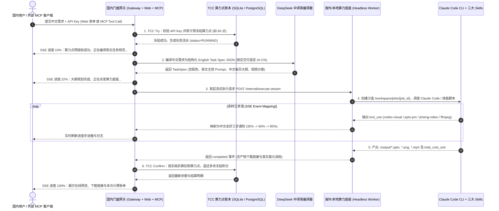
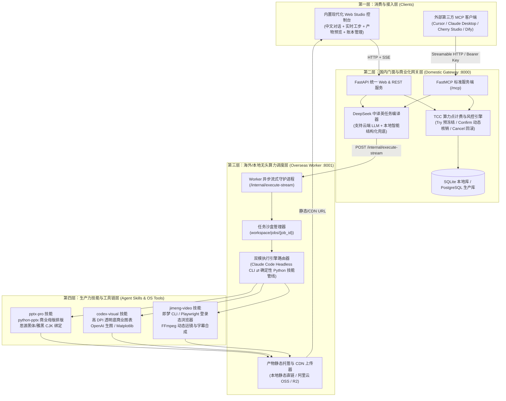

# Personal Agent ProMedia Platform — 产品设计、系统架构设计与工程实现设计说明书

> **版本**：v1.0.0 (Production & Local All-in-One Ready)  
> **定位**：基于 MCP 协议与“国内门面接待 + 海外/本地 Claude Code 重工底座”的商业级 PPT 与 AIGC 短视频智能生产平台

---

## 第一部分：产品设计 (Product Design)

### 1.1 产品愿景与核心价值主张
传统多智能体框架（Multi-Agent Chat）在面向生产力交付物（如商业级 PPT、营销短视频）时，普遍存在**空转寒暄多、Token 消耗失控、国内网络访问受阻、交付产物排版粗糙**四大痛点。

本产品（**Personal Agent ProMedia Platform**）采用 **“内脑轻量接待编译 + 外脑确定性技能重工”** 的双核解耦范式，同时服务两类核心客群：
1. **C 端 / 职场与自媒体创作者（通过自有 Web Studio 工作台）**：
   - 零门槛输入中文一句话需求（如*“做一份 8 页的智能穿戴设备海外众筹路演 PPT，科技深色风，并配一条 10 秒产品宣传视频”*）。
   - 毫秒级获得中文大纲反馈，通过可视化实时进度步进器（Stepper UI）观察后台工步，最终直接在线预览和下载可编辑的 `.pptx` 源文件、高清配图与 `.mp4` 营销成片。
2. **B 端开发者 / AI 应用集成商（通过标准 MCP Server 接口）**：
   - 使用平台签发的 `sk-mcp-xxxx` 算力密钥，一行配置即可将本平台的 **商业级 PPT 引擎** 与 **即梦 AI 视频合成引擎** 挂载至 Cursor、Claude Desktop、Cherry Studio、Dify 或企业内部飞书 Bot。
   - 平台通过 **TCC（Try-Confirm-Cancel）三阶段算力点账本** 自动完成预授权冻结、按真实美元消耗动态核销与失败全额退费。

---

### 1.2 核心功能矩阵 (Feature Matrix)

| 模块域 | 功能名称 | 功能描述与验收标准 | 优先级 |
| :--- | :--- | :--- | :--- |
| **1. 创作工作台 (Web Studio)** | 中文需求与多模态参数配置 | 支持选择任务类型（PPT 生成、营销视频生成、PPT+视频全案）、页数（5~15页）、视觉主题（科技深色、商务极简、活力撞色等）、视频时长与画幅比例（16:9 / 9:16）。 | P0 |
| | 实时工步流式看板 (Live Stepper) | 基于 SSE 实时展示：算力点预冻结 -> DeepSeek 中译英任务规格编译 -> 海外/本地技能调度 -> 配图与图表渲染 -> 幻灯片/视频合成 -> 实耗结算全过程。 | P0 |
| | 产物画廊与在线预览下载 | 在线展示生成的双语任务规格 JSON、每页幻灯片大纲、生成的图表/插画预览、HTML5 视频在线播放，以及 `.pptx` / `.mp4` 一键高速下载。 | P0 |
| **2. 商业化与计费 (TCC Billing)** | 算力点钱包与 API Key 管理 | 内置演示账户与自定义 API Key 生成器（`sk-mcp-...`），实时显示“可用算力点”、“冻结中算力点”、“累计消费”与快捷充值模拟。 | P0 |
| | TCC 三阶段事务账本 | 任务开始前原子化冻结积分（Try）；成功完成后按海外真实 `total_cost_usd` 与保底公式多退少补（Confirm）；任何异常立即全额解冻退回（Cancel），附带完整审计流水表。 | P0 |
| **3. 开放生态网关 (MCP Server)** | 标准 MCP 协议端点 (`/mcp`) | 暴露 `create_pro_presentation`、`create_jimeng_marketing_video`、`create_composite_campaign` 三个标准 MCP 工具，支持外部 MCP Client 鉴权调用与进度通知。 | P0 |
| **4. 核心生产力技能库 (Agent Skills)** | `pptx-pro`（商业 PPT 引擎） | 自动生成 16:9 宽屏商业幻灯片（封面页、核心痛点页、数据图表页、架构对比页、路线图页、总结页），强制绑定中文字体防乱码，内嵌高清图表，支持 LibreOffice 视觉质检闭环。 | P0 |
| | `codex-visual`（数据图表与配图） | 支持调用 OpenAI Image API / Codex 或本地高 DPI Matplotlib/Pillow 矢量渲染引擎，生成与 PPT 主题色严格匹配的透明底商业图表与概念插画。 | P0 |
| | `jimeng-video`（分镜视频合成） | 支持即梦 AI CLI / API 通道、持久化登录态 Playwright 浏览器通道，以及基于 FFmpeg 的多镜头动态运镜、中文字幕烧录与背景音轨合成兜底管线。 | P0 |

---

### 1.3 用户交互与全链路业务流程



---

## 第二部分：系统架构设计 (Architecture Design)

### 2.1 四层物理与逻辑解耦架构
为兼顾**“本机一键开发体验（Local All-in-One）”**与**“生产环境跨国双机部署（Domestic + Overseas Split）”**，系统设计为四层松耦合架构，仅通过环境变量即可切换单机或跨国分布式运行：



### 2.2 核心架构技术决策与工程修正（针对原方案的实战增强）

在审计你现有的两份方案与本机环境（macOS + Python 3.13 + Node 22 + Claude Code 2.1.293 + FFmpeg）后，我们在架构上做了 **4 项关键工程级增强**，确保代码不仅“看着合理”，而且**100% 能在当前机器上直接跑通出成果**：

1. **Claude Code CLI 真实参数兼容与双模执行引擎（Dual-Mode Execution）**：
   - **发现问题**：原 HTML 方案中使用了 `claude --bare` 参数，但在真实 Claude Code v2.1.293 中，`--bare` 会强制跳过 Keychain/OAuth 登录态且拒绝 `bypassPermissions`。
   - **架构增强**：Worker 执行层支持 **`auto` / `claude_cli` / `deterministic_skill`** 三种模式切换：
     - 当启用 `claude_cli` 模式时，自动适配 `--dangerously-skip-permissions -p --output-format stream-json --verbose --add-dir ...`，完美兼容本机 OAuth 登录态与环境变量 `ANTHROPIC_API_KEY`。
     - 当处于无外网 API Key 或追求极速确定性出片时，自动切换/回退至 **内置确定性技能执行管线（Deterministic Skill Pipeline）**，直接调用技能库下的 Python 渲染脚本生成真实 `.pptx`、高清 `.png` 数据可视化图表与 `.mp4` 视频，保证演示与开发永不卡壳。
2. **中译英编译器（Task Compiler）的云端 + 本地双引擎**：
   - 当配置了 `DEEPSEEK_API_KEY` 或 `OPENAI_API_KEY` 时，实时请求大模型生成定制化 `TaskSpec` JSON。
   - 当未配置 API Key 时，内置 **启发式领域知识编译器（Heuristic Domain Compiler）**，根据用户输入的中文主题、页数、风格自动拆解出结构完整的中文商業幻灯片大纲（含高管摘要、市场规模数据、核心技术架构、竞争壁垒、商业化路径、财务预测等）与视频分镜脚本。
3. **数据库零依赖启动与生产无缝迁移**：
   - 采用统一的异步仓储层设计：默认使用本机 SQLite（存储于 `data/platform.db`），无需安装或启动笨重的外部数据库即可完整运行 TCC 冻结、核销、退款与账单查询；同时保留生产级 PostgreSQL SQL 迁移脚本与 `docker-compose.yml`。
4. **真实多模态产物闭环（非 Mock 空文件）**：
   - **PPT 产物**：使用 `python-pptx` 编写多版式商业幻灯片生成引擎（深色科技母版、卡片式网格布局、高对比度 KPI 指标卡、原生矢量形状装饰、自动嵌入高 DPI 透明底数据图表），生成的 `.pptx` 可直接用 PowerPoint / Keynote / WPS 打开编辑。
   - **图表与配图产物**：使用 `matplotlib` + `Pillow` 生成 300 DPI 透明底商业图表与视觉配图，自动适配 macOS 中文字体（`PingFang SC` / `Heiti TC` / `Arial Unicode MS`）与 Linux 中文字体（`Noto Sans CJK SC`），彻底杜绝中文方块乱码。
   - **视频产物**：优先调用即梦 CLI / API；当本机未配置即梦密钥时，自动调用你本机已安装的 `/opt/homebrew/bin/ffmpeg` 结合生成的分镜高分辨率帧、动态缩放平移滤镜（Ken Burns 运镜效果）、淡入淡出转场与合成环境音轨，生成真正可播放的 1080P `.mp4` 营销短片。

---

## 第三部分：工程实现设计 (Implementation Design)

### 3.1 项目统一工程目录树 (`/Users/flyignick/Code/person-work`)

```text
/Users/flyignick/Code/person-work/
├── README.md                                  # 快速启动、架构说明与 API/MCP 接入指南
├── requirements.txt                           # Python 依赖清单
├── .env.example                               # 环境变量模板（支持单机/跨国双机配置）
├── start_platform.sh                          # 一键启动脚本（同时拉起海外 Worker :8001 与国内网关 :8000）
├── docker-compose.yml                         # 生产环境容器编排（Gateway + Worker + PostgreSQL + Nginx）
├── docs/
│   └── PRODUCT_ARCHITECTURE_IMPLEMENTATION_DESIGN.md  # 本设计说明书
├── sql/
│   └── init_postgres_schema.sql               # 生产级 PostgreSQL 表结构脚本
├── gateway/                                   # 【国内门面与商业化网关层】
│   ├── __init__.py
│   ├── config.py                              # 配置管理
│   ├── billing_tcc.py                         # TCC 三阶段算力点计费引擎（支持 SQLite / Postgres）
│   ├── deepseek_compiler.py                   # DeepSeek 中译英任务规格编译器（含本地智能编译器）
│   ├── mcp_server.py                          # FastMCP 对外标准 MCP Server 工具集封装
│   ├── main.py                                # 国内网关主入口（REST API + SSE 代理 + MCP + Web UI）
│   └── static/
│       └── index.html                         # 现代化暗黑科技风 Web Studio 控制台 & 计费管理后台
├── worker/                                    # 【海外/本地高性能算力底座层】
│   ├── __init__.py
│   ├── worker_api.py                          # 算力底座流式守护进程 (FastAPI :8001)
│   ├── oss_uploader.py                        # 产物归档与静态/CDN URL 签名器
│   ├── mcp_configs/
│   │   └── playwright_jimeng.json             # Playwright MCP 持久化登录态浏览器配置
│   └── agent_skills/                          # 注入 Claude Code 的标准化技能库
│       └── .claude/
│           └── skills/
│               ├── pptx-pro/
│               │   ├── SKILL.md               # PPT 商业排版与视觉自检技能定义
│               │   └── scripts/
│               │       └── build_deck.py      # 商业级 .pptx 幻灯片自动排版渲染脚本
│               ├── codex-visual/
│               │   ├── SKILL.md               # Codex / 视觉配图与图表生成技能定义
│               │   └── scripts/
│               │       └── generate_visual.py # 300 DPI 透明底商业图表与视觉插画生成脚本
│               └── jimeng-video/
│                   ├── SKILL.md               # 即梦 AI 视频生成与 FFmpeg 合成技能定义
│                   └── scripts/
│                       └── jimeng_pipeline.py # 即梦 CLI/API + FFmpeg 1080P 动态运镜视频合成管线
├── nginx/
│   └── mcp_gateway.conf                       # 防 60s 超时的 Nginx SSE 长连接反向代理配置
└── workspace/                                 # 运行时沙盒目录（自动创建）
    ├── data/                                  # 本地 SQLite 账本数据库
    └── jobs/                                  # 各任务独立沙盒与输出产物 (/workspace/jobs/{job_id}/output/)
```

---

### 3.2 核心数据模型与接口契约设计

#### 1. 中译英编译器输出契约 (`TaskSpec` JSON Schema)
国内门面将中文简短指令扩写为如下标准结构，发送给执行底座：
```json
{
  "task_summary_cn": "智能穿戴设备海外众筹 8 页高管路演 PPT 与 10 秒宣传片",
  "deliverable_lang": "zh-CN",
  "visual_style": "executive-dark",
  "palette": {
    "bg": "#0B0F19",
    "surface": "#161F33",
    "primary": "#38BDF8",
    "accent": "#6366F1",
    "emerald": "#10B981",
    "text": "#F8FAFC",
    "muted": "#94A3B8"
  },
  "english_execution_prompt": "Use /pptx-pro and /codex-visual skills to build an 8-slide widescreen presentation...",
  "kpis": [
    {"label": "目标众筹金额", "value": "$2.5M", "delta": "+320% YoY"},
    {"label": "端侧推理延迟", "value": "12 ms", "delta": "行业领先 4x"},
    {"label": "硬件综合毛利率", "value": "58.4%", "delta": "BOM 极致优化"},
    {"label": "早鸟预订转化率", "value": "18.7%", "delta": "高于均值 2.4x"}
  ],
  "slide_outline": [
    {
      "slide_num": 1,
      "layout": "cover",
      "action_title_cn": "某智能穿戴品牌：下一代 AI 随身硬件全球众筹路演",
      "subtitle_cn": "端云协同个人智能体硬件生态 · 商业计划与产品发布",
      "bullets_cn": ["主打北美与西欧极客高净值人群", "全天候生理指标监测与 AI 实时语音助理", "预计 Q4 启动 Kickstarter 百万美元众筹"],
      "visual_type": "hero_banner",
      "chart_data": null
    }
  ],
  "video_scenes": [
    {
      "scene_num": 1,
      "duration_sec": 4,
      "title_cn": "破界而生 · 全天候 AI 随身智能引擎",
      "subtitle_cn": "轻至 18g 钛合金机身 · 毫秒级多模态感知交互",
      "jimeng_prompt_cn": "赛博朋克暗黑科技风，精密钛合金智能穿戴设备微距特写，蓝色流光粒子环绕，电影级光影，4K",
      "camera_motion": "zoom_in"
    }
  ]
}
```

#### 2. TCC 算力点计费规则设计
- **预冻结定额（Try）**：
  - `ppt`（单份商业 PPT 生成）：预冻结 **60 算力点**（折合人民币约 ¥4.0）。
  - `video`（单条营销短视频生成）：预冻结 **80 算力点**（折合人民币约 ¥5.3）。
  - `composite`（PPT + 视频全案生成）：预冻结 **120 算力点**（折合人民币约 ¥8.0）。
- **动态实耗核销公式（Confirm）**：
  $$\text{Charged Credits} = \min\left(\text{Frozen}, \max\left(\lfloor \text{Frozen} \times 0.7 \rfloor, \lceil \text{Actual Cost USD} \times 300 \rceil\right)\right)$$
  既保证平台至少有 3 倍以上的 Token 毛利安全垫，又能在轻量任务中自动退还多余冻结积分（多退少补），提升用户好感度。
- **异常全额回滚（Cancel）**：
  若执行超时、子进程返回非 0 状态码或网络中断，自动将 `credits_frozen` 全额退回 `credits_available`，并在 `credit_ledger` 记录 `REFUND` 流水。

#### 3. 核心 API 与 MCP 接口清单
- **网关 REST / SSE 接口 (`http://localhost:8000`)**：
  - `GET /`：Web Studio 交互式创作工作台与账本管理界面
  - `GET /api/wallet?api_key=sk-mcp-...`：查询当前 API Key 绑定的用户信息、算力点余额与流水账单
  - `POST /api/wallet/topup`：模拟微信/支付宝充值算力点
  - `POST /api/wallet/keys`：创建新的对外 MCP API Key
  - `POST /api/jobs/stream`：提交创作任务并通过 SSE 实时接收全链路进度与最终产物
  - `GET /api/jobs`：获取历史创作任务列表与产物下载链接
  - `POST /mcp`：FastMCP 标准 Streamable HTTP 端点，供 Cursor / Claude Desktop 挂载
- **底座内部调度接口 (`http://localhost:8001`)**：
  - `POST /internal/execute-stream`：接收网关加密请求，创建沙盒，执行 Claude Code / 技能脚本并流式返回进度事件
  - `GET /artifacts/{job_id}/{filename}`：静态高速分发生成的 `.pptx`、`.png`、`.mp4` 文件
